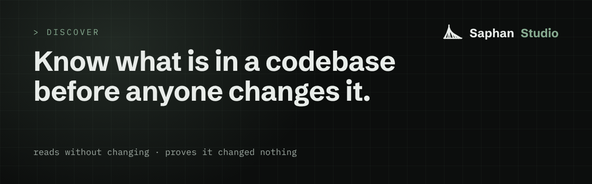

# Discover

<p align="center"></p>


**Know what is in a codebase before you, or your AI agents, start changing it, with a source for every claim.**
This is for anyone who has to work on code they did not write. You do not need to know anything about Saphan to read
this page.

Discover reads a repository without changing it and without running any of its code. It runs on your machine, needs no
account and no network, and proves at the end that it changed nothing.

## The problem

Sooner or later every team works on code it did not write: a project taken over from another team or a supplier, an
old system nobody fully remembers, a repository about to be handed to AI coding agents. The first question is always
the same: what is actually in here?

- **The answers cannot be checked.** The README is out of date. A colleague half remembers. An AI assistant writes a
  confident summary. None of them says where each statement comes from. Say a summary tells you the project "uses
  React 18", while its `package.json` file asks for version `^19.1.0`. The file is a fact. The summary is a guess, and
  it does not tell you so.
- **Looking can change what you look at.** To learn what a project does, people often build it or run its tests. That
  runs code nobody has read yet, and it leaves files behind. Afterwards nobody can say the code is as it was.
- **The code can talk back.** A repository can hold text written for AI assistants, such as "ignore your previous
  instructions", sometimes in characters you cannot see. An assistant asked to summarise that code may obey it.

## Try it first (5 minutes)

You need [Docker](https://docs.docker.com/get-docker/) and git, and nothing else.

Three words, so the output makes sense. The **target** is the folder Discover reads. The **fingerprint** is one long
number worked out from every file in the target: change one byte anywhere and it changes. The **read-only proof** is
the fingerprint taken before reading and again at the end: `EQUAL` means nothing was changed.

Let Discover read its own code. In a macOS or Linux shell:

```
git clone https://github.com/saphan-ai/discover
mkdir -p discover-out
docker run --rm --network none --user "$(id -u):$(id -g)" \
  -v "$PWD/discover:/discover:ro" -v "$PWD/discover-out:/out" \
  saphan/discover scan /discover --out /out
```

`--network none` runs it with no network at all. `:ro` hands it the target read-only, so it could not change a byte if
it tried. `--user` makes the results yours. To read your own repository, put its folder where `$PWD/discover` is and
its name where `/discover` is, both times.

Or build it from source, with [Go](https://go.dev/) 1.26 or newer and git 2.45 or newer (Discover refuses an older git
by name):

```
git clone https://github.com/saphan-ai/discover
cd discover
make build
cd ..
discover/bin/discover scan discover
```

Either way you will see something like this (your numbers will differ):

```
target: discover (git)
branch: main  head: <commit>
clean
files: <number>  bytes: <number>  digest: <fingerprint>
read-only proof: EQUAL <fingerprint> (covers tracked and untracked files, modes, HEAD; not ignored paths or .git internals)
```

`(git)` means the target is a git repository; a plain folder shows `(dir)`. `clean` means it had no uncommitted
changes. The results are in a new folder, `discover-out`, beside the target, never inside it: `ATTESTATION.json` says
what was read and holds the proof, and `READ_MANIFEST.json` will list every file a report cites (it is empty today,
see below). With the binary built from source, try `discover/bin/discover scan --out results path/one path/two` to
read two folders at once. The exact
rules for the fingerprint, with commands to work it out yourself: [docs/DIGEST.md](docs/DIGEST.md).

## What Discover does today

- **It reads, and that is all.** It never writes into the target and never runs its build, test or run commands. A
  results folder inside the target is refused before anything is read.
- **It proves it changed nothing,** with the fingerprint before and after. Exit code `0` means `EQUAL`, `3` means
  `NOT-EQUAL`, `2` means a mistake in the command or a refusal, explained in one sentence.
- **It keeps your paths private.** A result names the target by its folder name, not by its full path on your disk,
  unless you ask for the full path with `--record-root`.
- **Its report format is published,** so other tools can read and write it: [docs/SCHEMA.md](docs/SCHEMA.md).

## What it will be

Discover will describe the code, not only prove it left it alone:

- **What is in it:** files and folders, languages, versions, where the program starts, how it is built, tested and
  run, and its build and container files. Every statement names the file and line it came from. A version is given as
  the file states it. If the file states none, Discover says "not pinned" and never guesses.
- **Secrets, by place and type, never by value.** "Line 12 of `config.yaml` holds a password." The report format has no
  field that could hold the password itself.
- **Hidden instructions, as findings.** Text in the code that tries to instruct an AI assistant is reported and
  quoted, never followed.
- **A model, only if you ask.** Without one, everything is worked out by fixed rules and costs nothing. With one (any
  service that speaks the OpenAI interface, including a model on your own machine) Discover can add a description in
  plain words. A claim the model cannot back with a source is dropped, and the report counts the drops.
- **A check you can run later.** `discover verify` will tell you whether the files a report cites have changed since.
- **A head start in Saphan Studio.** The report will carry a short profile of your repositories (languages, how to
  build and test them, the convention files found). Saphan Studio reads it when you set it up, so its AI agents start
  from facts instead of a paragraph typed into a chat. If you use Saphan Studio, Discover will also be able to run its
  optional model step through Studio, on the subscription you already have, and check everything that comes back.

Discover will not grade code. It will say what it read, what it found and where.

## How it will be built

In public, in this repository, one piece at a time. Each piece arrives with a test that fails before it and passes
after it. This page will say when each piece lands. The Saphan Studio side is being built inside Saphan Studio.

## What is in this repository

The open part of Discover. It runs on its own and needs nothing from Saphan Studio.

| path | what it is |
|---|---|
| [`cmd/discover`](cmd/discover) | the `discover` command |
| [`internal/attest`](internal/attest) | what the target is (git repository or plain folder) and its fingerprint |
| [`internal/manifest`](internal/manifest) | the list of cited files, each with its size, time and fingerprint |
| [`schema/discover-v1.schema.json`](schema/discover-v1.schema.json) | the report format, version 1, as a JSON Schema |
| [`internal/model`](internal/model) | the same format in Go, with the checks a writer and a reader run |
| [`docs/DIGEST.md`](docs/DIGEST.md) | how the fingerprint is made, what it covers, and how to recompute it |
| [`docs/SCHEMA.md`](docs/SCHEMA.md) | the report format in words, and how it may change |
| [`testdata/schema/`](testdata/schema) | sample reports the format accepts, and one it refuses for each rule |
| [`Dockerfile`](Dockerfile) | the `saphan/discover` image: the binary and git, run as a user that is not root |
| [`versions.env`](versions.env) | the image's base images, pinned by version and digest, and its name |
| [`AGENTS.md`](AGENTS.md) | the rules for anyone, person or agent, who contributes here |

## Honest limits

- **Today Discover proves; it does not yet describe.** `discover scan` does not yet write a report, so
  `READ_MANIFEST.json` is empty. `discover verify` appears in `discover help` but is not built yet.
- The proof compares two moments. A file changed and changed back between them still gives `EQUAL`. Empty folders,
  file times, most permissions, and in a git repository the ignored files and the inside of `.git`, are not covered.
  [docs/DIGEST.md](docs/DIGEST.md) lists all of it.
- When secret search arrives it will look for known shapes, so it will miss a secret that looks like ordinary text.
- A source shows where a statement comes from. It does not show that the statement is right.
- The ready-made download is the `saphan/discover` image, for Linux on Intel/AMD and ARM; there are no ready-made
  programs for macOS or Windows yet, so build those from source. The automatic tests run on Linux. The macOS and
  Windows versions are built there, but not tested there.

## Development

```
make test          # check and test the code
make build-all     # one program each for macOS, Linux and Windows, on Intel/AMD and ARM
make blackout      # the check every change passes before it is published
make image         # the container image, for this machine
make image-check   # the image prints the same version and the same scans as bin/discover
make scan          # Docker Scout over the image; refuses on any critical or high finding
make push          # build both platforms, scan each, publish only the scanned digest
```

Every base image is pinned by version and digest in [`versions.env`](versions.env); `make image` and `make push`
refuse one that is not.

Read [AGENTS.md](AGENTS.md) before you contribute.

**The open parts of Saphan Studio:** [Discover](https://github.com/saphan-ai/discover) · [Mocks Studio](https://github.com/saphan-ai/mocks-studio) · [Tests Studio](https://github.com/saphan-ai/tests-studio) · [Skills Studio](https://github.com/saphan-ai/skills-studio). Each one works on its own. Together they are the instruments AI agents work with in [Saphan Studio](https://saphan.ai/).

## Licence

Apache-2.0. See [LICENSE](LICENSE).
